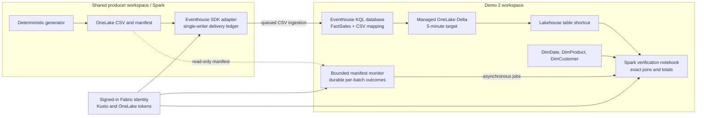

# Demo 2: Eventhouse and OneLake availability

The shared producer submits the same staged CSV bytes to an Eventhouse using
queued ingestion. The KQL table is exposed as a managed OneLake Delta table and
read through a Lakehouse shortcut, where Spark joins it to the shared dimensions.
The shortcut is not a second user-managed copy; OneLake materialization is
asynchronous and is not instantaneous or copy-free.



## Prerequisites and configuration

- An active Fabric capacity and permission to create and run items in the
  dedicated demo workspace. Authenticate to the intended tenant; the scripts
  respect the existing `AZURE_CONFIG_DIR` and do not switch a global profile.
- Python 3 and the packages in `requirements.txt` for local deployment and SDK
  checks. The producer's Fabric environment must also contain the Kusto SDK:
  the default runtime used for the MCAP probe did not. A later no-sales probe
  loaded the pinned SDK and bundled adapter in a published environment. The
  locally tested versions are `azure-kusto-data==6.0.4` and
  `azure-kusto-ingest==6.0.4`.
- The shared `demo-data-generator/generator.py` and its v1 manifest/delivery
  contract. Notebook definitions embed the checked-in generator and Demo 2
  verification modules at build time; they do not install packages at runtime.
- The database name, actual query and ingestion endpoints, sales table, named
  mapping, Lakehouse, and shortcut in the shared configuration. Discover the
  endpoints from the KQL database item rather than constructing them from names.
  A non-null per-demo `verification_timeout_seconds` overrides the global
  value; the default is 900 seconds. The reusable verifier keeps `run_id`
  null and takes the current run's manifest as a job parameter; a new run
  still requires its own reservation and readiness proof.

The documented narrow KQL role combination for an existing table is Database
User plus Table Ingestor. Query verification also needs database read access.
The permissions needed to discover SDK status queues should be checked for the
actual identity. The MCAP test used an existing workspace Admin; it did **not**
establish that a narrower combination is sufficient, and no new grants were
made. See [queued ingestion permissions](https://learn.microsoft.com/en-us/kusto/management/data-ingestion/queued-ingest-status-http?view=microsoft-fabric).

## Deployment and presentation

Use the common config and the per-track interface, or the top-level
orchestrator. Use absolute paths and a persistent state directory isolated by
tenant and prefix. Reuse that directory for every invocation so the monitor's
original job and child ownership records survive restarts; write each result
to a separate file:

```powershell
python demo-2-eventhouse\deploy.py --mode dry-run --config C:\demo\config.json --prefix chanel --state-dir C:\demo\state --result C:\demo\demo2-dry-run.json
python demo-2-eventhouse\deploy.py --mode deploy --config C:\demo\config.json --prefix chanel --state-dir C:\demo\state --result C:\demo\demo2-deploy.json
python demo-2-eventhouse\deploy.py --mode validate-only --config C:\demo\config.json --prefix chanel --state-dir C:\demo\state --result C:\demo\demo2-validate.json
```

Deployment must report `blocked`, not ready, if an artifact, permission,
dimension, ingestion path, policy, shortcut, or runtime check is unverified.
The current CLI always blocks deployment readiness until a fresh,
authoritative producer-runtime identity and permission probe is integrated.
Monitor readiness also remains blocked until that proof is bound to the
verified artifacts, dimensions and effective configuration.
The manually created MCAP workspace also lacks the CLI's ownership ledger and
markers; it is not automatically adopted.
`resolve-target-candidate` reads the existing ownership ledger and exclusively
creates `demo-2-target-candidate.json` beside the result. It reports `ready:false`:
the candidate is not a live ownership or access proof. Monitor starts require
the complete selected `shared.target_bindings` map and bind it, the normalized
generator digest and the producer configuration into the immutable start
record. Changed bindings require a new monitor; stopping an existing monitor
uses its original recorded identity, including for legacy records.
Run the shared producer only after fresh validation passes for it and every
selected destination. `submitted` means queued, not ingested.

1. Inspect the KQL schema, `SalesCsvV1` mapping and applied mirroring policy.
2. Start the monitor and confirm its live `monitor-status` is ready before the
   producer runs. The orchestrator uses the track's `start-monitor`,
   `monitor-status`, `wait-monitor` and `stop-monitor` modes with the same
   config and state directory.
3. Run the producer for the selected, ready demos. The monitor independently
   reads its durable manifest and launches bounded shortcut-verification jobs;
   Spark waiting does not block the one-minute generator. Each batch deadline
   is based on the recorded delivery, not when verification starts.
4. Confirm the monitor's terminal completion and per-batch outcomes. Each
   measured batch must have matching terminal ingestion evidence, KQL
   reconciliation, all three dimension joins, exact decimals and grouped
   totals. A final run-wide check rejects sales keys duplicated within the run
   or already present in another batch, including the retained bootstrap.
5. Use only manifest-selected measured BatchIDs in any additional KQL or
   Lakehouse aggregate. Do not aggregate all rows in `FactSales`: bootstrap and
   negative-test batches are not part of the measured results.

The monitor's read-only producer snapshot never modifies the producer manifest.
It writes its own OneLake state and holds a conditional writer lock. The local
`demo-2-monitor-start.json` records the original owned job separately from the
mutable status sidecar. Stop and recovery must reconcile those exact identities
and any recorded child jobs. An uncertain submission, missing start record or
retained lock is a blocker; do not guess an operation ID or blindly restart.
Until prior-source serialization evidence is available, a duplicate-tag skip
is unresolved even when KQL totals match.

Two concurrent bootstrap verification jobs succeeded in MCAP, but Fabric
reported high-concurrency mode disabled for both. Do not assume those jobs
share a Spark session without separately verifying the workspace configuration
and execution mode. Fabric requires the workspace's
[high-concurrency setting](https://learn.microsoft.com/en-us/fabric/data-engineering/configure-high-concurrency-session-notebooks)
and compatible identity, workspace, Lakehouse and libraries.

The producer's staging helper copies each closed OneLake file to driver-local
storage and checks its SHA-256 before calling `EventhouseAdapter.submit`; its
Fabric runtime path still needs verification. The adapter uses the
named CSV mapping, ignores the header, and uses matching `ingestIfNotExists`
and `ingest-by` tags. `ingestion_status(source_id)` peeks at status queues
without deleting messages; absence of a terminal message is not proof of
failure or permission to retry. Match the terminal source ID and then verify
the KQL result. Unknown or in-flight submissions require reconciliation, not a
blind retry. The SDK's bounded peeks can miss messages behind other queue
entries, so an unavailable terminal result remains unresolved.

Serialized replay was verified for the bootstrap below. This does not prove
concurrent duplicate submissions are safe or exactly-once delivery in general:
the producer must serialize writers and retain its durable ledger. KQL extent
tags have retention and performance implications; do not rely on a deleted
extent's tag to prevent a later replay.

The finalized shared producer uses globally unique `SalesLineID` reservations.
The local verifier checks the run identity, normalized packaged-generator
digest, canonical inclusive range, count, and measured keys. Its independent
registry validator was exercised with synthetic fixtures, but is not yet
connected to live, independently verified target identities or a quiesced
retained-key inventory. No live reservation has been established. A manifest
or scan of mirrored data cannot replace that durable, exclusive reservation
or prove that other writers are stopped.

## OneLake semantics and troubleshooting

OneLake availability is a **read-only managed Delta representation**, not the
source CSV. Database retention also governs the OneLake data; deleting a staged
CSV does not delete ingested KQL or mirrored rows. The configured
`TargetLatencyInMinutes=5` is the documented minimum target, not an SLA.
Adaptive batching and ingestion batching are separate; the documented default
queued-ingestion batching policy is five minutes. A shorter OneLake target can
produce many small files, and the resulting read-only table cannot be optimized
by the consumer. In the MCAP readback, the table-specific ingestion batching
policy was null and the database policy was 20 seconds, 500 items and 300 MB.
These settings are separate from the OneLake target. See [OneLake availability](https://learn.microsoft.com/en-us/fabric/real-time-intelligence/event-house-onelake-availability)
and [ingestion batching](https://learn.microsoft.com/en-us/kusto/management/batching-policy?view=microsoft-fabric).
Do not collect or report propagation-latency statistics for this demo.

If a shortcut is missing or empty, read the applied policy and resolve the
actual KQL database item and table path; never substitute the Eventhouse or
Lakehouse item ID. Confirm `_delta_log` is readable and the shortcut target
matches, then run the bounded verification. A timeout, orphaned key, incorrect
decimal, mismatched total, malformed CSV, missing SDK or unresolved queue status
is a failure or blocker, not a successful demonstration.

## MCAP evidence and accounting

The sanitized `evidence-mcap.json` records the isolated resource identifiers,
policy, shortcut, and observed outcomes. The live bootstrap
`demo2bootstrap_80b398bcea53_0001` remains in KQL and its mirrored Delta table:
it has five rows totaling 526232 minor units. It is classified `bootstrap` and
must be excluded from every measured count, total and grouped aggregate. Its
retained `SalesLineID` values are 1 through 5; a read-only KQL inventory found
no other fact batches. That historical inventory does not establish writer
quiescence. The separate malformed batch `demo2negative_5f7d11269579_0001` was
rejected before ingestion and has zero KQL rows. Deleting their staged files
is not cleanup of the KQL or mirrored data.

## Cleanup

Do not delete presentation resources automatically. After confirming the
ownership state and desired scope, use `--mode cleanup --yes` with the same
config, prefix and state directory. Cleanup must refuse ambiguous or unowned
resources and must not affect other demo workspaces. The current CLI only
removes a confirmed owned empty workspace; populated resources require explicit
ownership-aware cleanup.
