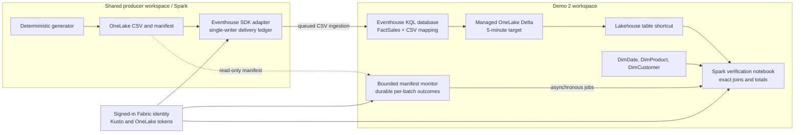

# Demo 2: Eventhouse and OneLake availability

The shared producer submits the same staged CSV bytes to an Eventhouse using
queued ingestion. The KQL table is exposed as a managed OneLake Delta table and
read through a Lakehouse shortcut, where Spark joins it to the shared dimensions.
The shortcut is not a second user-managed copy; OneLake materialization is
asynchronous and is not instantaneous or copy-free.



## Prerequisites and configuration

- An active Fabric capacity and permission to create and run items in the
  dedicated demo workspace. Authenticate to the intended tenant; the scripts
  respect the existing `AZURE_CONFIG_DIR` and do not switch a global profile.
  On Windows, token requests invoke the Azure CLI MSI Python directly; other
  batch launchers are blocked because their timeouts cannot be guaranteed.
- Python 3 and the packages in `requirements.txt` for local deployment and SDK
  checks. The producer's Fabric environment must also contain the Kusto SDK:
  the default runtime used for the MCAP probe did not. A later no-sales probe
  loaded the pinned SDK and bundled adapter in a published environment. The
  locally tested versions are `azure-kusto-data==6.0.4` and
  `azure-kusto-ingest==6.0.4`.
- The shared `demo-data-generator/generator.py` and its v1 manifest/delivery
  contract. Notebook definitions embed the checked-in generator and Demo 2
  verification modules at build time; they do not install packages at runtime.
- The database name, actual query and ingestion endpoints, sales table, named
  mapping, Lakehouse, and shortcut in the shared configuration. Discover the
  endpoints from the KQL database item rather than constructing them from names.
  A non-null per-demo `verification_timeout_seconds` overrides the global
  value; the default is 900 seconds. The reusable verifier keeps `run_id`
  null and takes the current run's manifest as a job parameter; a new run
  still requires its own readiness proof.

The documented narrow KQL role combination for an existing table is Database
User plus Table Ingestor. Query verification also needs database read access.
The permissions needed to discover SDK status queues should be checked for the
actual identity. The MCAP test used an existing workspace Admin; it did **not**
establish that a narrower combination is sufficient, and no new grants were
made. See [queued ingestion permissions](https://learn.microsoft.com/en-us/kusto/management/data-ingestion/queued-ingest-status-http?view=microsoft-fabric).

## Deployment and presentation

Use the common config and the per-track interface, or the top-level
orchestrator. Use absolute paths and a persistent state directory isolated by
tenant and prefix. Reuse that directory for every invocation so the monitor's
original job and child ownership records survive restarts; write each result
to a separate file:

```powershell
python demo-2-eventhouse\deploy.py --mode dry-run --config C:\demo\config.json --prefix chanel --state-dir C:\demo\state --result C:\demo\demo2-dry-run.json
python demo-2-eventhouse\deploy.py --mode deploy --config C:\demo\config.json --prefix chanel --state-dir C:\demo\state --result C:\demo\demo2-deploy.json
python demo-2-eventhouse\deploy.py --mode validate-only --config C:\demo\config.json --prefix chanel --state-dir C:\demo\state --result C:\demo\demo2-validate.json
```

Deployment must report `blocked`, not ready, if an artifact, permission,
dimension, ingestion path, policy, shortcut, or runtime check is unverified.
For explicitly reused synthetic targets, readiness checks the Azure CLI
tokens against the configured producer principal, its direct workspace write
role, and Kusto query access. The producer notebook must independently recheck
its actual runtime identity, role, target and queue access before staging; a
CLI check does not claim that runtime has already executed. Other monitor
targets remain blocked without a complete readiness binding.
The manually created MCAP workspace also lacks the CLI's ownership ledger and
markers; it is not automatically adopted.
`resolve-target-candidate` holds the deployment ledger lock while reading the
existing ledger and exclusively creating `demo-2-target-candidate.json` beside
the result. It reports `ready:false`:
the candidate is not a live ownership or access proof. Monitor starts require
the complete selected `shared.target_bindings` map and bind it, the normalized
generator digest and the producer configuration into the immutable start
record. Each manifest snapshot must match that generator, configuration, selected
destination set and complete target map. Changed bindings require a new monitor;
stopping an existing monitor uses its original recorded identity, including for
legacy records.
`verify-target-ownership` is the read-only counterpart. It requires the
existing non-pending deployment ledger and checks the live workspace,
Eventhouse, parent-linked KQL Database, and table schema/docstring against
that exact record. It does not emit a portable attestation or establish
producer permissions and always reports `ready:false`.
Run the shared producer only after fresh validation passes for it and every
selected destination. `submitted` means queued, not ingested.

1. Inspect the KQL schema, `SalesCsvV1` mapping and applied mirroring policy.
2. Start the monitor and confirm its live `monitor-status` is ready before the
   producer runs. The orchestrator uses the track's `start-monitor`,
   `monitor-status`, `wait-monitor` and `stop-monitor` modes with the same
   config and state directory.
   The monitor deadline is `W*T + D + 1170 + V` seconds after submission,
   where `W = max(4, ceil(4/C) + 1)`, `C` is the configured admission
   concurrency, `T` is the track timeout, `D` is the producer's maximum
   duration, and `V` is the verification timeout. The four validators cover
   up to three demos and the producer; the extra wave covers monitor status.
   The additional 120 seconds covers producer admission token acquisition.
   Earlier `W*T + D + 1050 + V`, `4*T + D + 1050 + V`, and `2*T + D + V`
   records remain reconcilable.
3. Run the producer for the selected, ready demos. The monitor independently
   reads its durable manifest and launches bounded shortcut-verification jobs;
   Spark waiting does not block the one-minute generator. Each batch deadline
   is based on the recorded delivery, not when verification starts.
4. Confirm the monitor's terminal completion and per-batch outcomes. Each
   measured batch must have matching terminal ingestion evidence, KQL
   reconciliation, all three dimension joins, exact decimals and grouped
   totals. Completion independently rereads each batch from the owned KQL
   table and checks its persisted verification timestamp against its
   deadline. A final run-wide check verifies row counts and unique sales keys
   within each measured batch.
5. Use only manifest-selected measured BatchIDs in any additional KQL or
   Lakehouse aggregate. Do not aggregate all rows in `FactSales`: bootstrap and
   negative-test batches are not part of the measured results.

The monitor's read-only producer snapshot never modifies the producer manifest.
It writes its own OneLake state and holds a conditional writer lock. The local
`demo-2-monitor-start.json` records the original owned job separately from the
mutable status sidecar. Stop and recovery must reconcile those exact identities
and any recorded child jobs. An uncertain submission, missing start record or
retained lock is a blocker; do not guess an operation ID or blindly restart.
Until prior-source serialization evidence is available, a duplicate-tag skip
is unresolved even when KQL totals match.

The monitor launches independent on-demand notebook jobs; they do not need to
share a high-concurrency Spark session.

For the native producer, `native_demo2.py` uses the producer-allocated run ID
and its existing manifest path. The producer must bundle `monitor_controller.py`,
`lakehouse_validation.py`, and `eventhouse_core.py` alongside it. At profile
publication, pin the measured verifier and monitor item IDs and the SHA-256
digests of their trusted ipynb projections (`definition_sha256`), the target
Lakehouse and shortcut, and an existing bootstrap batch. Do not derive the
expected digests from unreviewed live notebook definitions. The hooks check the
live definitions, run a bootstrap verification, and require a fresh owned
monitor heartbeat before the first sale. Producer transport completion alone
is not pipeline success: the hooks independently reconcile every measured
batch and the whole-run verifier output. They do not rebind notebook definitions
per run.

The native job journal is `Files/producer/runs/<run_id>/demo2-native-jobs.json`
in the producer staging Lakehouse. On cooperative stop, reconcile the recorded
monitor first, then its exact child jobs and writer lock. A lost submission
receipt or unconfirmed child termination retains the producer's native run lock;
never resubmit or clear it blindly. A hard termination may bypass cooperative
cleanup. The profile and this lifecycle require coordinated live verification
before they can be presented as repeatable.

The producer's staging helper copies each closed OneLake file to driver-local
storage and checks its SHA-256 before calling `EventhouseAdapter.submit`. This
path was verified for the bounded synthetic run below, not for a measured run.
The adapter uses the
named CSV mapping, ignores the header, and uses matching `ingestIfNotExists`
and `ingest-by` tags. `ingestion_status(source_id)` peeks at status queues
without deleting messages; absence of a terminal message is not proof of
failure or permission to retry. Match the terminal source ID and then verify
the KQL result. Unknown or in-flight submissions require reconciliation, not a
blind retry. The SDK's bounded peeks can miss messages behind other queue
entries, so an unavailable terminal result remains unresolved.

Serialized replay was verified for the bootstrap below. This does not prove
concurrent duplicate submissions are safe or exactly-once delivery in general:
the producer must serialize writers and retain its durable ledger. KQL extent
tags have retention and performance implications; do not rely on a deleted
extent's tag to prevent a later replay.

### Controlled synthetic monitoring

Use the reserved prefix `demo2synthetic-<12 lowercase hex>` and corresponding
run ID `demo2synthetic_<12 lowercase hex>`. `provision-synthetic` creates and
journals the dedicated workspace, Eventhouse, KQL Database, Lakehouse,
`SyntheticFactSales`, mapping and policy. It neither ingests nor reports
readiness. Do not supply IDs for unowned resources or reuse a production state
directory. A distinct staging workspace publishes the regular manifest format
under the reserved run ID, with `batch_class: bootstrap` and exactly one
destination, the isolated Demo 2 target.

The explicit test modes are `prepare-synthetic-monitor`,
`start-synthetic-monitor`, `synthetic-monitor-status`, and
`wait-synthetic-monitor`, each with `--selected-demos demo-2`; use
`stop-monitor` with the same config and state to reconcile the exact owned
jobs. Preparation journals the dimension-preload job and verifies the owned
notebook definitions and shortcut before the short-lived runtime proof is
obtained. It neither starts the monitor nor reports readiness. Synthetic
completion uses the same KQL/Spark
checks and deadlines as production but always reports `ready:false`. Live
start requires `synthetic_proof` locators for the producer workspace, staging
Lakehouse, notebook, environment, pipeline, fresh preflight parent/child jobs
and nonce, separate authorization parent/child jobs, source and service
operation IDs, and the notebook, effective-config and authorization-CSV
SHA-256 digests. These are locators, not trusted claims: admission rereads the
live definitions, jobs, manifest, CSVs, KQL and status queue. It admits only
the bounded two-file, five-row bootstrap fixture and blocks on stale or
ambiguous evidence. Neither a local fixture nor the creation journal is
runtime access proof. Production readiness remains separately blocked.

The MCAP synthetic run `demo2synthetic_38bb0e3e0d0e` completed end to end using
producer workspace `48593f2f-d3ac-474b-ba96-08282d6f69df`, staging Lakehouse
`fca649c9-0297-4997-8e2d-8ac5338aaa1a`, and this isolated destination:

```json
{
  "workspace_id": "0a0499fe-51b5-42b1-bc99-31c121cc74a6",
  "item_id": "25159007-a6dd-4020-8afc-01d393378727",
  "fact": "SyntheticFactSales"
}
```

The mapping was `SalesCsvV1`; the Eventhouse was
`a585c196-beb8-432a-bf11-f0f2530de92c` and the target Lakehouse was
`f565aeac-f321-46f2-8262-076e06490707`. Each of the two batches was delivered
once and independently verified through KQL and the Lakehouse shortcut:
five rows totaling 526232 minor units and five rows totaling 351377 minor
units, respectively. The monitor and its batch and run-wide verifiers
completed. A separate authorization-probe row is not part of those batches.
This historical result does not authorize another run or target.

To evaluate reusing this dedicated target for the normal demonstration, keep
the original owner prefix and state directory. With the measured data config
and `demo-2.sales_table: SyntheticFactSales`, use `resolve-target-candidate`
to recover the exact destination from its journal, then
`verify-target-ownership` to check it live against `shared.target_bindings`.
These modes do not authorize measured execution. The candidate's `item_id`
is the `SalesDatabase` KQL database, not the Eventhouse or Lakehouse.

For seed 42 and start date `2026-01-01`, the synthetic dimensions (4 dates,
3 products, 3 customers) are generated subsets of the normal dimensions
(365 dates, 20 products, 100 customers). Set
`demo-2.reuse_synthetic_target: true` and supply the original prefix, state
directory, exact target binding and common producer settings. With a
coordinated window and other dimension writers stopped:

1. Run `prepare-measured-monitor` with the normal track arguments and
   `--selected-demos`. It reconciles the recorded old monitor and children,
   archives their records, and creates separately owned measured verifier and
   monitor notebooks. It does not start a monitor or establish readiness.
2. Run `expand-compatible-dimensions --yes` with the same arguments. It checks
   workspace Spark sessions and owned notebook jobs, validates all three
   dimensions before inserting missing keys, and verifies the full result.
   `check-dimension-gaps` is the read-only alternative. No existing row is
   updated. If a maintenance outcome is uncertain or failed, reconcile its
   exact journaled job and dimensions before attempting another write.
3. Supply a complete existing `demo-2.verification_batch` and run
   `validate-only` before starting the monitor. Its verifier checks that batch
   through KQL and the shortcut, including all dimension joins. The job
   records the exact run, generator, target, batch and Delta transaction-log
   snapshots. Repeated validation rechecks those snapshots, live metadata,
   roles and query access. During producer admission, add
   `--require-existing-proof` to fail closed without starting another Spark job
   if that proof is missing or stale. Snapshot drift requires a new verification
   when no monitor or other Spark writer is active.

The measured verifier is bound to the selected dimensions and its monitor
definition pins the exact owned synthetic target; neither is the old synthetic
notebook. `wait-monitor` permits the expected shortcut changes from ingestion,
but requires unchanged dimension snapshots and independently verifies the
measured batches and run. The bootstrap batch is readiness evidence, not a
customer result: filter retained bootstrap and authorization rows out using
the measured manifest's batch IDs.

The producer uses `SalesLineID` values 1 through the row count in each batch,
reusing those values across batches and on replay. The fact key is
`(BatchID, SalesLineID)`, not `SalesLineID` alone. The verifier checks each
batch's count and distinct keys separately; other batches, including retained
bootstrap data, may use the same IDs. No global allocator or retained-key
inventory is needed. The batch manifest and stable ingestion tag still bind
replay to its original batch, and ambiguous or concurrent submissions require
the delivery ledger and reconciliation described above.

## OneLake semantics and troubleshooting

OneLake availability is a **read-only managed Delta representation**, not the
source CSV. Database retention also governs the OneLake data; deleting a staged
CSV does not delete ingested KQL or mirrored rows. The configured
`TargetLatencyInMinutes=5` is the documented minimum target, not an SLA.
Adaptive batching and ingestion batching are separate; the documented default
queued-ingestion batching policy is five minutes. A shorter OneLake target can
produce many small files, and the resulting read-only table cannot be optimized
by the consumer. In the MCAP readback, the table-specific ingestion batching
policy was null and the database policy was 20 seconds, 500 items and 300 MB.
These settings are separate from the OneLake target. See [OneLake availability](https://learn.microsoft.com/en-us/fabric/real-time-intelligence/event-house-onelake-availability)
and [ingestion batching](https://learn.microsoft.com/en-us/kusto/management/batching-policy?view=microsoft-fabric).
Do not collect or report propagation-latency statistics for this demo.

If a shortcut is missing or empty, read the applied policy and resolve the
actual KQL database item and table path; never substitute the Eventhouse or
Lakehouse item ID. Confirm `_delta_log` is readable and the shortcut target
matches, then run the bounded verification. A timeout, orphaned key, incorrect
decimal, mismatched total, malformed CSV, missing SDK or unresolved queue status
is a failure or blocker, not a successful demonstration.

## MCAP evidence and accounting

The sanitized `evidence-mcap.json` records the isolated resource identifiers,
policy, shortcut, and observed outcomes. The live bootstrap
`demo2bootstrap_80b398bcea53_0001` remains in KQL and its mirrored Delta table:
it has five rows totaling 526232 minor units. It is classified `bootstrap` and
must be excluded from every measured count, total and grouped aggregate. Its
retained `SalesLineID` values are 1 through 5; a read-only KQL inventory found
no other fact batches. Those IDs may be reused by later batches. The separate
malformed batch `demo2negative_5f7d11269579_0001` was rejected before ingestion
and has zero KQL rows. Deleting their staged files is not cleanup of the KQL or
mirrored data.

## Cleanup

Do not delete presentation resources automatically. After confirming the
ownership state and desired scope, use `--mode cleanup --yes` with the same
config, prefix and state directory. Cleanup must refuse ambiguous or unowned
resources and must not affect other demo workspaces. The current CLI only
removes a confirmed owned empty workspace; populated resources require explicit
ownership-aware cleanup.
